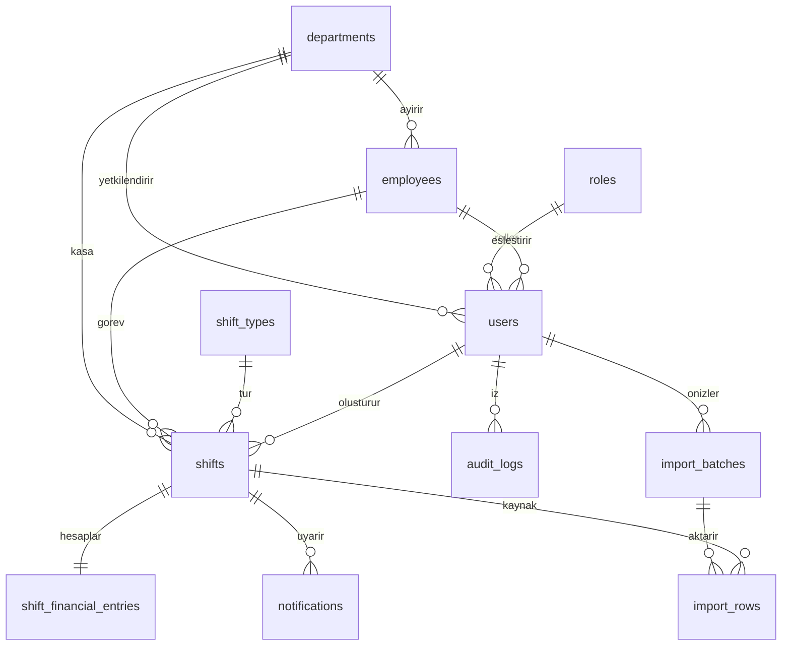

# Mimari ve veri bütünlüğü

`application_settings` işletme ayarlarını tutar. Laravel'in migrations, sessions, cache ve jobs tabloları altyapı içindir. Rollerin yetkileri policy/controller içinde açıkça tanımlıdır; serbest düzenlenebilen izin editörü yoktur.

## Sınırlar

- Bir vardiya tek departman, personel ve vardiya türüne bağlıdır. Personelin departmanı ile vardiyanın departmanı composite foreign key ile de doğrulanır.
- Personelin geçmişi ya da kullanıcı hesabı varsa departmanı yerinde değiştirilmez. Diğer departmana ayrı personel kaydı açılır; finansal geçmiş yerinde kalır.
- Personel rolü yalnızca eşlenmiş personel ve departmanda kayıt açar, kendi oluşturduğu kayıtları okur, yalnızca taslak/sayım durumunda düzenler. Yönetici yalnızca yetkili departmanını yönetir. Süper yönetici tüm departmanları yönetir.
- Okuma sorguları `Shift::visibleTo` kapsamından geçer. İçe aktarma partileri yalnızca oluşturan yetkili kullanıcı tarafından görülüp onaylanır. Yedek ve sistem ayarları süper yöneticiye aittir.
- Login throttling e-posta+IP ile uygulanır, şifre hash'leri Laravel tarafından üretilir. Public kayıt veya hazır yönetici yoktur.

## Finansal kayıt yaşam döngüsü

Hesaplar `ShiftCalculator` içinde girdilerden yeniden üretilir; istemcinin gönderdiği hesaplanan alanlar kullanılmaz. Para girişi negatif olmayan, en fazla iki ondalıklı, 11 tam basamaklı tutardır. `Money` kuruş çevirisi string parçalama kullanır. Raporlar da her kaydı kuruş bazında toplar; float parasal hesaplama yapılmaz. Chart.js ve canlı önizleme gösterim içindir; kayıt yetkisi backend'dedir.

Boş `counted_cash` NULL'dır, `difference` da NULL'dır. `0.00` gerçek sayımdır. Bozuk para boşsa sıfır kabul edilir, sayılan nakit boşken bozuk para tek başına sayımı tamamlamaz. `credit`/`points` markette sıfırdan farklı olamaz.

Taslak/sayım/kontrol/onay bekliyor durumları formdan seçilir. Yöneticinin onay işlemi yalnızca kontrol/onay bekleyen ve sayılmış vardiyada geçerlidir. Fark varsa gerekçe gerekir. Kapatmak için önce onay gerekir. Onaylı/kapalı kaydı personel değiştiremez; yönetici gerekçeyle düzeltip yeniden iş akışına alır. Önceki kapalı durum korunmuş gibi gösterilmez.

Güncellemede satır kilidi ve version eşleşmesi gerekir. Aynı kaynak vardiyanın ikinci kaydı eşzamanlı işlemlerde DB unique constraint ile de korunur. Aynı personelin aynı tarih/türde ek kaydı için yönetici gerekçesi ve sıra numarası gerekir. Arşivlenmiş kayıtlar da mükerrer kontrolüne dahildir. Onaylı/kapalı kayıt arşivlenemez; önce gerekçeli düzeltme yapılmalıdır.

Finansal yazma, denetim izi ve bildirim aynı transaction içindedir. Denetim kayıtlarında önce/sonra finansal tutarlar ve kullanıcı kimliği vardır. HTTP üzerinden audit düzenleme/silme rotası yoktur. DB yöneticisinin erişimine karşı fiziksel değişmezlik garanti edilmez; canlı ortamda DB erişimini ayrıca sınırlandırın.

## İçe aktarma ve dışa aktarma

OOXML arşiv boyutu/dosya boyutu/satır sınırları uygulanır. VBA çalıştırılmaz. Hesaplanan hücreler alınmaz; gerçek giriş hücresindeki formül tutar olarak kabul edilmez. Önizlemede kişisel/finansal veriler uygulama veritabanında saklanır ve yetkili kullanıcıya gösterilir. Her partide ayrı başarı/atlama/hata sayıları tutulur; hatalı satır başarılıymış gibi sayılmaz. Hata veren satırın personel/kayıt oluşturması da savepoint ile geri alınır.

XLSX dışa aktarmada tüm hücreler formül enjeksiyonunu engellemek için açıkça metin türünde yazılır; hesap sonuçları tutar metnidir. Yeni Excel hesabı oluşturmak isteyen kullanıcı bu alanları bilinçli olarak sayıya çevirebilir. KAYITLAR içe/dışa aktarma şeması uygulamaya aittir.

Raporlar günlük, haftalık (Pazartesi başlangıcı), aylık, yıllık, departman, banka, personel, fark, gider ve durum bazında gruplar üretir. HTML/PDF/XLSX aynı filtrelenmiş veri kümesinden gelir. Sayfalama yalnızca detay ekranındadır; çıktı tüm filtrelenmiş kayıtları içerir. Kapalı ve taslak dahil arşivlenmemiş kayıtlar raporlanır; yalnızca kesinleşmiş kayıtlar için durum filtresini kullanın. Kasa farkı toplamına yalnızca sayılmış kayıtlar girer.

## İşletim

MySQL 8.4 ve PHP 8.4 konteynerleri geliştirme içindir. Canlı yayın ayrı web sunucusu ve HTTPS ister. Oturumlar DB'dedir. MySQL hacmi canlı işlemleri, filesystem ise kod/bağımlılıkları saklar; kod snapshot'ı tek başına canlı DB yedeği değildir. Yayında ayrı MySQL yedekleme ve geri yükleme prosedürü gerekir.
